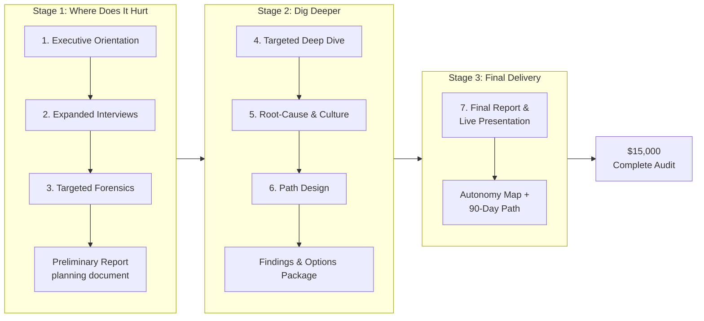

# CAO AI Audit Process Diagram

**Visual concept:** Horizontal three-stage flow using buyacorn.com branding (deep green #1A3C34, warm gold #D4A017, cream #F5F5F5).

**Price:** $15,000 for the full engagement.

First version for team communication. Iterate as needed.
