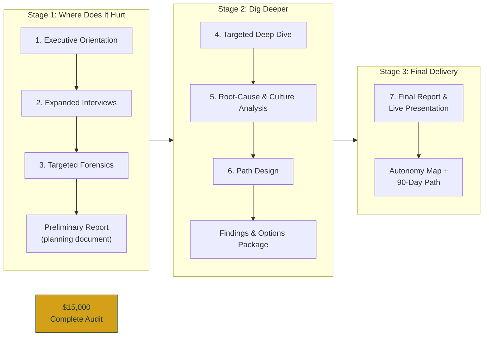

# CAO AI Audit — Three Stages, Seven Steps (Corrected)

**This diagram matches the locked written structure exactly.**

**Structure locked:**
- Stage 1: Steps 1–3 + Preliminary Report
- Stage 2: Steps 4–6 + Findings & Options Package
- Stage 3: Step 7 only + Autonomy Map + 90-Day Path

Branding: deep green #1A3C34, warm gold #D4A017.
